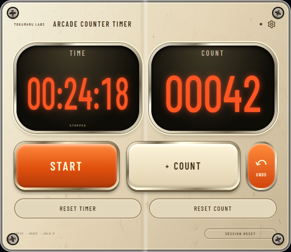

English | [日本語](README_JA.md)

# Arcade Counter Timer

[Chrome Web Store](https://chromewebstore.google.com/detail/arcade-counter-timer/cfonffmpidgimppooikhhhlceaoipkeb) · [What changed](CHANGELOG.md)

## 0.3.0: six themes and repeatable undo

In settings choose DISPLAY MODE: Popup / Floating / Side panel, then OPEN
SELECTED VIEW. The next toolbar click remembers the selected mode. Floating
mode supports dragging, arrow-key movement, position lock and compact/full size.
It operates only on a web page where the user invokes the extension; restricted
browser pages cannot host it. Side-panel position follows browser settings.
Chrome 116+ is required. Other Chromium browsers require separate acceptance.

Normal updates of the same extension ID retain saved statistics and settings.
The 0.2.0 update also keeps a local pre-update snapshot and stops pruning daily
history older than 400 days. Already-pruned data cannot be recovered.
Do not uninstall/reinstall to update: uninstall and confirmed CLEAR ALL DATA
remove stored records. All views share one serialized writer.

A themed NEW FEATURE strip appears below COUNT on the first visible main view
after a version upgrade. It has one finite scan, stays readable until dismissed
or the view closes, and never replays on reopening. Fresh installs show no notice.
Skipped releases list only features added since the previous version.

Permissions: storage, activeTab, scripting, sidePanel. No persistent host access,
remote services or telemetry. A user-triggered content script places only the
timer UI; a service worker serializes local state changes. See PRIVACY.md.


A count-up timer and tally counter that stays out of your way, and turns into a
small arcade machine for a fraction of a second when you hit a milestone.



Version 0.3.1 · by Tokumaru Labs · Chrome Extension (Manifest V3)

## What it does

Two things, well:

- **A count-up timer** — `HH:MM:SS`, correct past 100 hours, that keeps running
  while the popup is closed and across browser restarts.
- **A tally counter** — one press, one count.

Everything else is feedback. Counting quickly earns a brief line of fly text,
and every 10th count sets off a short CHAIN burst with an original sound. The
effects last a few hundred milliseconds and never block input; if you would
rather work in silence, each one can be switched off.

## Features

- Count-up timer with start/stop and its own reset
- Session counter with its own reset
- Repeatable UNDO beside COUNT, including each operation's original-day statistics
- Session reset for both at once
- TODAY / WEEK / MONTH / YEAR statistics, kept locally
- Fly text on fast streaks (`GOOD!` → `NICE!` → `GREAT!` → `FANTASTIC!`)
- CHAIN milestone effect on every 10th count
- Original sound effects generated with the Web Audio API — no audio files
- Six visual themes: Space Age, Arcade, Editorial, Steampunk, Art Deco and Nixie
- A small local clock in the popup header
- Settings for sound, fly text, chain effect and the subtle CRT scanlines
- Works entirely offline, with no account

## Themes

Choose **Space Age**, **Arcade**, **Editorial**, **Steampunk**, **Art Deco** or
**Nixie** in settings. Space Age replaces Original as the default: an existing
Original preference maps to Space Age without altering timer, counts, history,
settings or the pending undo receipt. Arcade and Editorial remain available.

Space Age has ivory enamel, aluminium bezels and orange instrument glass.
Steampunk layers bundled machinery and brass gear artwork under mechanical
split flaps: only changed digits turn in two halves around the center hinge over
440ms, while the value updates immediately. Rapid counts and undo cancel stale
faces. Gears move a finite step when the count changes. Art Deco combines
emerald lacquer, gold inlays and Bodoni numerals. Nixie uses ten original photographs
of illuminated Z566M digits inside fixed glass housings and sockets, over scratched
steel. Each complete housing image keeps its original proportions and shows its
tip, glass body and socket together. The housing is an AI-edited derivative of a CC0 tube photo, not a precise
reproduction of a single hardware model. Accessible text remains available; a
failed image or forced-colors mode falls back to readable text. The four
material popups are 600×520 with equal TIME/COUNT instruments and tactile
controls; Arcade and Editorial remain 360×540. Side panels and floating views
adapt to their own width. Material faces show small counts with five digits
(00042); saved values, spoken labels and statistics still mean 42. Long counts and 100+ hour durations
fit the compact view; reduced motion skips or cancels flap and gear motion.

All six share the timer, counter, statistics, reset and undo logic. Themes are
saved locally. Artwork, fonts and their licenses are bundled; **ARTWORK & FONT
CREDITS** in settings opens the local attribution file. No runtime downloads.
Store screenshots above show the current UI with sample records.

## Main controls

| Control | Action |
| --- | --- |
| **▶ START / ■ STOP** | Start or stop the timer |
| **+ COUNT** | Add one to the count |
| **↶ UNDO** | Undo counts in reverse order, including their statistics |
| `RESET TIMER` | Hold 500 ms — timer only |
| `RESET COUNT` | Hold 500 ms — count only |
| `SESSION RESET` | Hold 650 ms — timer and count |
| ⚙ (gear) | Statistics and settings |

The timer readout and the big count area are also clickable, as mouse shortcuts
for the two buttons.

UNDO can be repeated until all retained successful COUNT operations are undone,
including after reopening a view or restarting the browser. Popup, floating and
side-panel views share the same history. A new COUNT adds a step after any undo;
there is no redo. Timer, count, session or full-data reset clears the undo history.
Start/stop, themes and settings keep it. Each undo corrects the count's original
local date, even after midnight, without rewinding the timer. Every successful
count or undo replaces the authorization token, so a repeated or stale request
cannot remove another count. Keyboard users can Tab to UNDO and press Space/Enter;
the existing global shortcuts are unchanged. Undo has a brief reverse-number
effect and status, without achievement effects or sounds, and respects reduced
motion. A failed save keeps all remaining undo steps available to retry.

Version 0.3.0 uses storage schema 4.
Schema 3's valid one-step receipt migrates as one undo step. Older counts are
never reconstructed from aggregate statistics. New counts add further steps.
Consecutive counts on the same local date share a compact run; there is no
arbitrary operation-count cap. Browser storage capacity and JavaScript's exact
integer range still apply: failed or unrepresentable operations do not change
saved counts or consume undo. Older schema-aware builds refuse to edit schema 4;
do not downgrade a profile that has been used with this source.

The optional `CLOCK` setting adds a small `NOW HH:MM:SS` local 24-hour clock to
the top bar. It is on by default and keeps running independently of the elapsed
timer. Finite arcade pulses mark second, minute and hour changes; the displayed
time still comes directly from the system clock, and delayed updates resynchronise
without replaying missed motion. Reduced-motion preferences suppress the effects.

## Keyboard

| Key | Action |
| --- | --- |
| `Enter` | Start / stop the timer |
| `Space` | +1 count |
| `R` (hold 650 ms) | Session reset |
| `Esc` | Back from statistics to the timer |

Auto-repeat is ignored, so holding a key never runs away with the count. When a
button has keyboard focus its own `Space` / `Enter` activation takes over, so one
keypress is always exactly one action. After a mouse, touch or pen press the
button hands focus back, and the shortcuts resume their global meaning.

## Resets

Every reset is press-and-hold; a short click does nothing, and releasing or
moving off the button early cancels it.

| Reset | Hold | Clears | Keeps |
| --- | --- | --- | --- |
| `RESET TIMER` | 500 ms | Timer only | Count, streak, statistics |
| `RESET COUNT` | 500 ms | Count, streak, chain state | Timer, statistics |
| `SESSION RESET` (or hold `R`) | 650 ms | Timer **and** count, streak, chain | Statistics, settings |
| `CLEAR ALL DATA` | confirmation dialog | Everything, including history and settings | — |

If the timer is running when it is reset, the time elapsed up to that moment is
credited to the correct day first, so statistics never lose it. Resetting the
count never decrements the count statistics.

## Statistics

The gear opens a second screen with TODAY, WEEK, MONTH and YEAR totals for both
time and count. Only a daily history is stored; the week (Monday to Sunday),
month and year totals are derived from it, so there is nothing to get out of
sync at a boundary. Timer intervals that cross local midnight are split at
midnight and credited to each day.

## Fly text and CHAIN

Counting faster than roughly one press every 650 ms builds a streak:

| Streak | Text |
| --- | --- |
| 3 | `GOOD!` |
| 5 | `NICE!` |
| 7 | `GREAT!` |
| 9 | `FANTASTIC!` |
| 13, then every 4th | `FANTASTIC!` |

Every 10th count of the session shows a CHAIN burst instead — `CHAIN!`,
`2 CHAIN!`, `3 CHAIN!` and so on — with a rising arpeggio, a few sparks and a
brief flash. The 50th and 100th add one extra note. Streaks live only as long as
the popup is open; they are never stored.

Reduced-motion preferences are respected: sparks, strong scaling and the flash
are toned down when the system asks for less motion.

## Install

To run the current source checkout manually:

1. Open `chrome://extensions`
2. Turn on **Developer mode**
3. Click **Load unpacked**
4. Select this project folder

## Development

No runtime build step, dependency or bundler. Vanilla HTML, CSS and ES modules.
Unit tests use Node's standard library. Native browser QA and screenshot capture
use an existing Playwright/Chromium development installation; set
`PLAYWRIGHT_MODULE` to its `node_modules/playwright` directory when it is outside
this checkout. Browser tooling is never included in the extension ZIP.

```
npm test              # existing behavior, upgrades, concurrency and notice lifecycle
npm run verify        # release checks: manifest, locales, permissions, icons, no remote code
npm run package       # build the Chrome Web Store ZIP into dist/
npm run prepare-update # rebuild screenshots, test, verify and package the update
npm run submission-kit # collect upload files and text in one dist/ folder
```

Helper scripts, none of which are needed to run the extension:

```
npm run icons         # re-render assets/icons/*.png from the SVG source
npm run capture       # screenshot the real popup with headless Chrome
npm run store-assets  # compose the 1280x800 store screenshots
```

Tests cover the pure logic — duration and clock formatting, clock lifecycle,
midnight/month/year interval splitting, Monday-based week ranges, the statistics
aggregates, the reset state transitions and the keyboard routing rules. They
import the same modules the extension uses. Browser checks run separately in
isolated profiles with synthetic records.

## Privacy

Everything happens on your machine. See [PRIVACY.md](PRIVACY.md) for the full
statement.

- **Permissions:** `storage`, `activeTab`, `scripting` and `sidePanel`
- No persistent host permissions; user-requested floating UI and a local state worker
- No network requests, no analytics, no ads, no account, no cloud sync
- Timer state, session count, daily history and settings live in
  `chrome.storage.local` on your device

## Current limitations

- Streaks are per-popup-session; closing the popup ends the current streak
- One timer and one counter — no named tasks or multiple counters
- Statistics are numbers only; no graphs or export
- Time that elapses while the popup is closed is credited to the correct days,
  but written to storage with the next timer, count or settings change
- If the system clock jumps backwards, the affected interval counts as zero
- Only the extension name and description are localized (English and Japanese);
  the popup interface itself is English only

## License

[GPL-3.0-only](LICENSE). Copyright © 2026 Tokumaru Labs.
